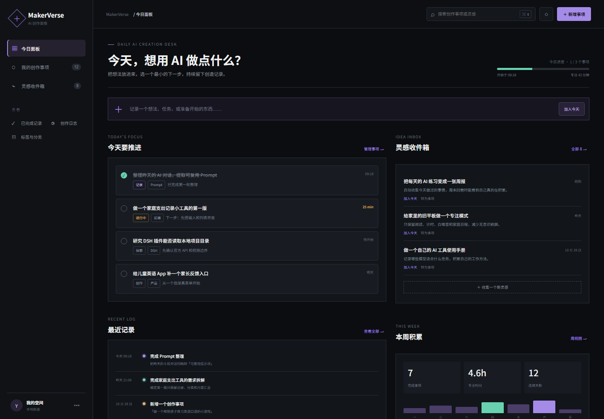
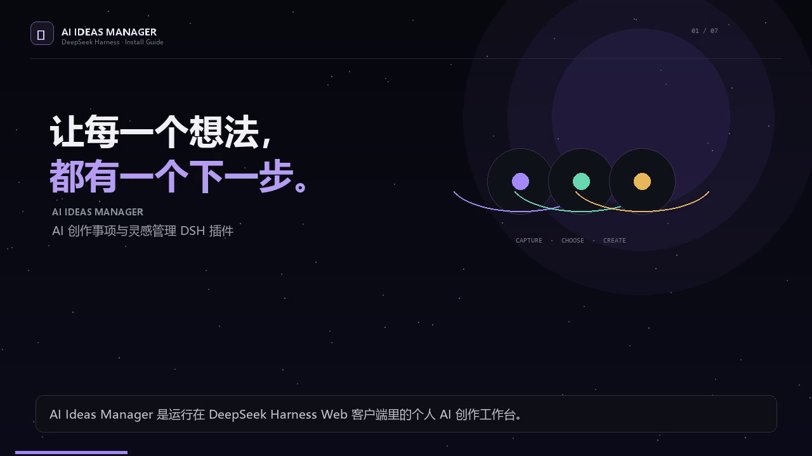

# AI Ideas Manager

运行在 DeepSeek Harness（DSH）Web 客户端里的个人 AI 创作工作台。

它把零散的灵感、今天要推进的事项、完成记录和创作日志放在一个安静的工作桌面里，帮助你把“想做什么”变成“下一步做什么”。



> 上图是最初的视觉原型。实际插件运行于 DSH，而不是独立网页。

## 安装演示视频

[](docs/install-demo.mp4)

点击封面观看约 2 分 09 秒的中文配音与字幕视频。

视频覆盖仓库获取、Web profile 安装、启动 DSH、打开工作台和创建第一条记录。字幕文件见 [install-demo.srt](docs/install-demo.srt)。

## 功能

- 今日面板：今日进度、今日专注事项、灵感收件箱和下一步建议。
- 快速收集：一句话直接加入今天，或先收进灵感收件箱。
- 创作事项：新增、编辑、完成、重开、删除，并支持状态筛选和排序。
- 灵感转事项：把值得尝试的灵感一键加入今天。
- 创作日志：自动记录新增、完成、重开、转化与删除，也可以手动记录进展。
- 本周积累：完成数、活跃天数和最近七天柱状图。
- 标签与分类：从事项与灵感中聚合标签和关注方向。
- 全局搜索：同时搜索事项、灵感和日志。
- 数据导出：导出版本化 JSON 备份。
- 中英文界面：跟随 DSH 当前语言切换。

## 运行环境

- DSH `0.2.1-rc.5` 已验证。
- Web 客户端。
- 无前端构建依赖，无第三方运行时 npm 依赖。

## 安装

先取得代码：

```powershell
git clone https://github.com/vincent-1223/ai_ideas_manager.git
Set-Location ai_ideas_manager
```

将本地包添加到 DSH Web profile：

```powershell
dsh plugin --profile web add (Get-Location).Path
```

如果没有全局 `dsh`，可以使用当前验证版本：

```powershell
npx --yes @deepseek-ai/dsh@0.2.1-rc.5 plugin --profile web add (Get-Location).Path
```

安装器会把包加入 `dsh.profile.bundles`。重启 `dsh web` 后，DSH 侧栏底部会出现“灵感”入口；点击后打开完整工作台，也可以使用 `Ctrl+J`（macOS 为 `⌘J`）。

## 使用

1. 在顶部快速输入框中输入一个想法。
2. 选择“加入今天”创建进行中事项，或选择“收进灵感”保存到收件箱。
3. 点击事项左侧圆圈完成事项；再次点击可重新打开。
4. 在灵感卡片中选择“转为事项”，把灵感安排到今天。
5. 在“标签与分类”页面导出 JSON 备份。

## 数据存储

数据保存在当前 DSH Web origin 的浏览器 `localStorage` 中：

```text
ai-ideas-manager:v1
```

- 首次运行写入可编辑、可删除的演示数据；之后启动不会覆盖用户数据。
- 每次变更都会立即写入当前工作区的内存状态和浏览器存储。
- 解析失败时，原始内容会备份到 `ai-ideas-manager:v1:corrupt:<timestamp>`，然后创建新的工作区。
- 写入失败时，界面会显示持久化错误，并提示导出 JSON。

## 本地开发

```powershell
npm run verify
```

该命令会检查：

- `client.js`、`index.js` 和验证脚本的 JavaScript 语法。
- bundle manifest 与 patch 文件。
- 客户端模块标识、服务注入、两个 DSH Slot 的注册。
- 中英文文案键完整性。
- 首次演示数据写入和损坏数据备份路径。

## 结构

```text
.
├── client.js          # DSH Web 客户端半边与完整界面
├── index.js           # Host 半边（当前无需 Host 能力）
├── cordis.patch.yml   # 注入 DSH profile 的插件行
├── locale/            # 插件管理器展示元数据
├── scripts/verify.mjs # 无依赖验证脚本
├── icon.svg
└── prototype/         # 设计参考，不参与插件运行
```

## 已知限制

- 当前只实现 DSH Web 客户端；桌面原生容器中的存储位置可能不同。
- 数据跟浏览器 origin 绑定，不跨端口、浏览器、设备或 DSH Home 同步。
- 清除站点数据会删除工作台数据，重要内容应先导出 JSON。
- MVP 不包含 AI 自动评估、GitHub 同步、封面生成、云端账号或多人协作。

## License

[MIT](LICENSE)
